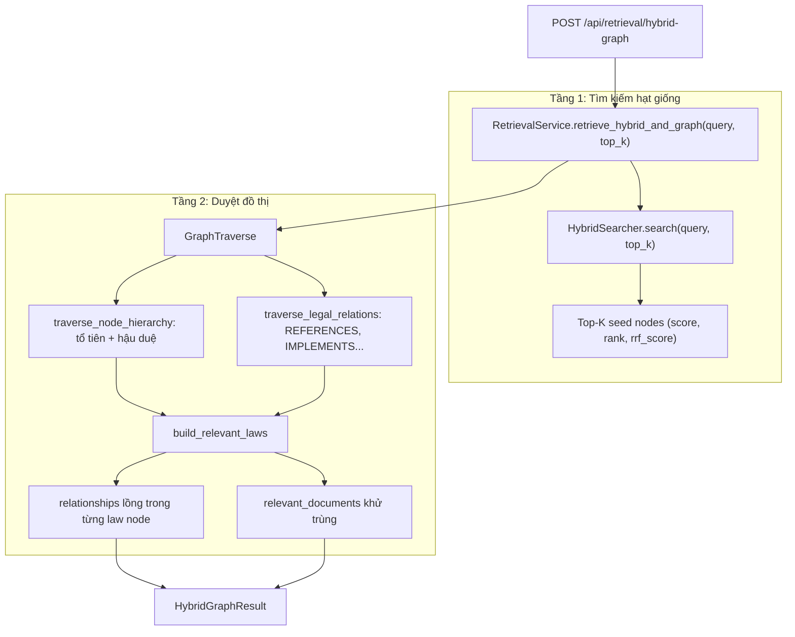

# V7 — Cập Nhật Tầng Retrieval Tinh Gọn (Hybrid Search + GraphTraverse Không LLM)

> **Trạng thái:** Hoàn thành phần code — chờ smoke test live với Neo4j
> **Người thực hiện:** Developer & Antigravity
> **Thời gian:** 2026-11-05
> **Phạm vi (Scope):** `backend` (`backend/src/retrieval/**`, `backend/src/api/**`, `backend/src/common/container.py`, `backend/scripts/test_hybrid_graph_retrieval.py`)
> **Next index theo `PLAN_INDEX.md`:** `7`
> **Nguyên tắc thiết kế (Code Simplification & Deep Modules):**
> 1. Tách biệt trách nhiệm: `GraphTraverse` sở hữu toàn bộ việc duyệt và cấu trúc hoá quan hệ đồ thị; `HybridSearcher` tìm kiếm kết hợp (BM25 + Semantic/RRF); `RetrievalService` chỉ còn vai trò orchestrator.
> 2. Loại bỏ bước gọi LLM trích xuất phân cấp trong luồng mới nhằm tối ưu tốc độ phản hồi.
> 3. Giữ nguyên `retrieve()` cũ và endpoint `/api/retrieval` để không phá vỡ tầng `services`/`frontend`.
> 4. **Không** thêm parser trích dẫn trong câu hỏi ở luồng mới — câu hỏi được xử lý thuần bằng Hybrid Search.
> 5. Xoá toàn bộ dead code trùng lặp trước khi thêm luồng mới (mỗi logic chỉ tồn tại một bản).

---

## 1. Mục Tiêu & Yêu Cầu Cốt Lõi

1. **Hàm retrieval mới không dùng LLM**:
   - `RetrievalService.retrieve_hybrid_and_graph(query_text, top_k=5)`.
   - Dùng trực tiếp `HybridSearcher` (BM25 + Dense Semantic với RRF) để lấy seed nodes kèm `score`, `rank`.
   - Không parse `Điều/Khoản` từ câu hỏi, không gọi model trích xuất phân cấp.
2. **`GraphTraverse` chịu trách nhiệm duyệt đồ thị**:
   - Duyệt tổ tiên và hậu duệ (`traverse_node_hierarchy`).
   - Duyệt quan hệ pháp lý ngoài `CONTAINS` (`traverse_legal_relations`).
   - Nhúng `relationships` vào từng law node và gom `Document` gốc (`build_relevant_laws`).
   - Dựng mảng cạnh phẳng cho luồng cũ (`build_flat_relationships`).
3. **Cấu trúc đầu ra mới** (`HybridGraphResult`): `input`, `relevant_laws` (mỗi node có `relationships` lồng nhau), `relevant_documents`.

---

## 2. Thiết Kế Chi Tiết Input / Output

### 2.1. Cấu trúc Output JSON

```json
{
  "input": "Người chưa thành niên có được tự mình thực hiện giao dịch dân sự không?",
  "relevant_laws": [
    {
      "node_id": "BLDS_2015_D21",
      "label": "Article",
      "number": 21,
      "title": "Điều 21. Người chưa thành niên",
      "full_text": "...",
      "document_id": "BLDS_2015",
      "parent_id": "BLDS_2015_P1_CH3",
      "citation": "Điều 21 Chương III Phần thứ nhất Bộ luật Dân sự 2015",
      "score": 0.032,
      "rank": 1,
      "rrf_score": 0.032,
      "semantic_rank": 1,
      "bm25_rank": 2,
      "retrieval_source": "hybrid[semantic+bm25]",
      "relationships": [
        {
          "relation_type": "CONTAINS",
          "direction": "INCOMING",
          "related_node": {
            "node_id": "BLDS_2015_P1_CH3",
            "label": "Chapter",
            "citation": "Chương III Phần thứ nhất Bộ luật Dân sự 2015"
          }
        },
        {
          "relation_type": "CONTAINS",
          "direction": "OUTGOING",
          "related_node": {
            "node_id": "BLDS_2015_D21_K1",
            "label": "Clause",
            "text": "Người chưa thành niên là người chưa đủ mười tám tuổi."
          }
        },
        {
          "relation_type": "REFERENCES",
          "direction": "OUTGOING",
          "related_node": {
            "node_id": "BLDS_2015_D125",
            "label": "Article"
          }
        }
      ]
    }
  ],
  "relevant_documents": [
    {
      "node_id": "BLDS_2015",
      "label": "Document",
      "title": "Bộ luật Dân sự 2015",
      "document_type": "LUAT",
      "effective_from": "2017-01-01",
      "status": "CON_HIEU_LUC"
    }
  ]
}
```

**Quy ước hướng quan hệ:**
- `CONTAINS` + `INCOMING`: node liên quan là **tổ tiên** của node gốc.
- `CONTAINS` + `OUTGOING`: node liên quan là **hậu duệ** của node gốc.
- Quan hệ pháp lý (`REFERENCES`, `IMPLEMENTS`, `INTERPRETED_BY`...): giữ hướng thật so với node gốc.

---

## 3. Kiến Trúc Phân Lớp



---

## 4. Các File Đã Thay Đổi

### 4.1. `backend/src/retrieval/graph_traverse.py` [REWRITE]
- Xoá wrapper `get_citation` (gọi trực tiếp `get_citation_path`).
- Xoá `get_children` trong duyệt phân cấp (đã nằm trong `get_descendants`).
- Thêm `_collect_hierarchy` trả về `(position, node)` để phân biệt tổ tiên/hậu duệ.
- Đổi `build_nested_law_nodes` → `build_relevant_laws`.
- Thêm `build_flat_relationships` (chuyển từ `RetrievalService._build_relationships`).

### 4.2. `backend/src/retrieval/retrieval_service.py` [MODIFY]
- Xoá `class GraphTraverse` trùng lặp (dead code, 158 dòng).
- Xoá `_collect_related_nodes`, `_collect_legal_relationships`, `_collect_related_documents`, `_build_relationships` (143 dòng).
- Xoá import trùng `LegalGraphService` và import không dùng `BaseLegalModel`.
- Inject `GraphTraverse` qua constructor (tự khởi tạo nếu không truyền).
- Thêm `retrieve_hybrid_and_graph`.
- `retrieve()` giữ nguyên hành vi, chuyển phần duyệt đồ thị sang `GraphTraverse`.

### 4.3. `backend/src/common/container.py` [MODIFY]
- Khởi tạo `GraphTraverse(graph_service)` và inject vào `RetrievalService`.

### 4.4. `backend/src/api/api_schemas.py` [MODIFY]
- Thêm model có type: `LegalNodeReference`, `LegalRelationship`, `HybridGraphLawNode`, `LegalDocumentReference`, `HybridGraphResult`.
- Thay `list[dict]` bằng model thật để OpenAPI có giá trị.

### 4.5. `backend/src/api/routes/retrieval.py` [MODIFY]
- Thêm `POST /api/retrieval/hybrid-graph`.
- Endpoint `/api/retrieval` cũ không đổi.

### 4.6. `backend/scripts/test_hybrid_graph_retrieval.py` [NEW]
- Kiểm tra hợp đồng bằng stub, không cần Neo4j.

---

## 5. Tiến Độ Triển Khai (Phases)

| Phase | Nội dung | Trạng thái |
|---|---|---|
| **P0** | Chốt tên hàm `retrieve_hybrid_and_graph`, bỏ parser citation, chốt contract 3 key | ✅ Hoàn thành |
| **P1** | Xoá dead code: `class GraphTraverse` trùng, 4 private `_collect_*`, import trùng/không dùng | ✅ Hoàn thành |
| **P2** | Viết lại `GraphTraverse`: `_collect_hierarchy`, `traverse_legal_relations`, `build_relevant_laws`, `build_flat_relationships` | ✅ Hoàn thành |
| **P3** | Thêm `RetrievalService.retrieve_hybrid_and_graph` và chuyển `retrieve()` sang dùng `GraphTraverse` | ✅ Hoàn thành |
| **P4** | Định nghĩa model Pydantic cho response + endpoint `/api/retrieval/hybrid-graph` | ✅ Hoàn thành |
| **P5** | Wiring `GraphTraverse` trong `container.py` | ✅ Hoàn thành |
| **P6** | Script kiểm tra hợp đồng (`scripts/test_hybrid_graph_retrieval.py`) | ✅ Hoàn thành |
| **P7** | Smoke test live với Neo4j + `scripts/test_retrieval.py` (regression luồng cũ) | ⏳ Chờ Neo4j bật |
| **P8** | Cập nhật `PLAN_INDEX.md` và ghi chú contract mới | ✅ Hoàn thành |

**Kết quả dòng code:**

| File | Trước | Sau |
|---|---|---|
| `retrieval_service.py` | 748 | 424 |
| `graph_traverse.py` | 214 | 209 |
| Số bản logic duyệt đồ thị | 3 | 1 |

---

## 6. Kế Hoạch Xác Minh (Verification Plan)

### Automated (không cần hạ tầng)

```powershell
cd backend
$env:PYTHONIOENCODING="utf-8"

# 1. Import sạch
python -c "import src.retrieval.retrieval_service, src.retrieval.graph_traverse, src.api.api_schemas, src.api.routes.retrieval"

# 2. Contract test
python scripts/test_hybrid_graph_retrieval.py

# 3. Format
black --line-length 88 src/retrieval src/api scripts/test_hybrid_graph_retrieval.py
isort --profile black src/retrieval src/api scripts/test_hybrid_graph_retrieval.py
```

Kết quả đã chạy: import OK, contract test OK, black/isort sạch.

### Manual (cần Neo4j)

```powershell
python scripts/test_retrieval.py          # regression luồng cũ
uvicorn src.api.server:app --port 8090    # rồi gọi POST /api/retrieval/hybrid-graph
```

**Tiêu chí đạt:**
- Response có đủ `input`, `relevant_laws`, `relevant_documents`.
- Mỗi law node có `relationships`; `CONTAINS` tổ tiên là `INCOMING`, hậu duệ là `OUTGOING`.
- `relevant_documents` không trùng lặp.
- Luồng cũ `/api/retrieval` trả đúng 6 key như trước.

---

## 7. Ghi Chú Còn Lại

- **N+1 citation**: mỗi node liên quan vẫn gọi `get_citation_path` (1 truy vấn ancestors). Với seed cấp `Chapter`, thời gian có thể vượt mục tiêu < 1s. Cần batch ancestors trong một lần truy vấn ở phase sau.
- **Chưa nối tầng `services`**: Go `aiclient` vẫn gọi `/api/retrieval` (luồng LLM). Muốn chat nhanh phải có plan riêng cập nhật `services` + frontend.
